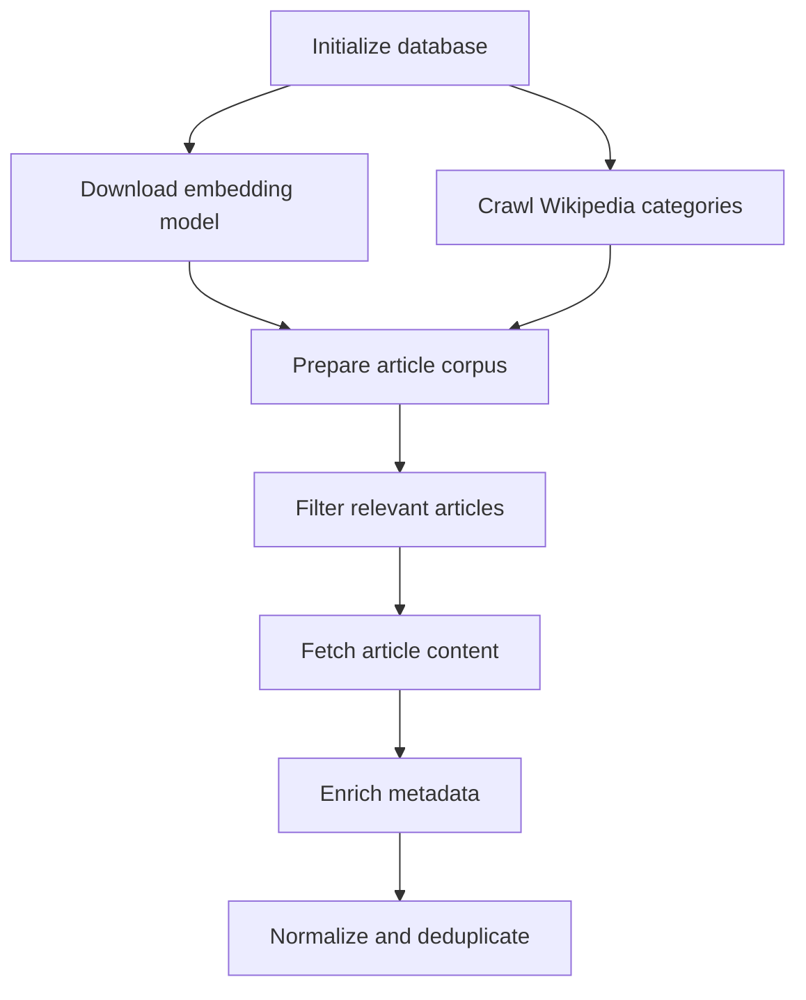

# PRI - Wikipedia Disaster Search

Information retrieval project for collecting, enriching and searching English Wikipedia articles about man-made disasters.

The project uses **Apache Airflow** to orchestrate data preparation, **SQLite** to track collection progress, **Sentence Transformers** to filter relevant categories, and **Apache Solr** to index and search the resulting corpus.

## Project resources

- [Report - Overleaf](https://www.overleaf.com/1278562841tmsyzbzykhwz#cb4f79)
- [ACM submission templates](https://www.acm.org/publications/authors/submissions)
- [Metadata enrichment documentation](docs/metadata.md)

## Data preparation pipeline

The DAG `wikipedia_disasters_crawler_pipeline` runs the following tasks:



1. **Initialize storage:** create the SQLite tables if they do not exist.
2. **Download the model and crawl Wikipedia:** cache `sentence-transformers/all-MiniLM-L6-v2` while exploring categories from `Category:Man-made disasters`. The crawler stores articles, memberships and category edges, and resumes categories not yet processed.
3. **Prepare fetching:** preserve or reset the raw corpus and fetch state according to the execution mode.
4. **Filter relevant articles:** compare category embeddings with topic embeddings. Multi-Otsu thresholds separate three relevance groups; parent relevance and parent–child similarity can promote categories. Articles in the final high-relevance group are selected.
5. **Fetch article content:** retrieve revision IDs, wikitext and Wikidata IDs for pending articles.
6. **Enrich metadata:** obtain structured values from Wikidata, with Wikipedia infoboxes as a fallback, and cache successful API responses.
7. **Normalize the corpus:** remove wiki markup and references, preserve selected template content and metadata, and deduplicate by `page_id`.

Solr indexing is performed separately after the DAG finishes.

## Installation and startup

Run commands from the repository root unless stated otherwise. Shell examples use Bash. For the host-side Python commands on Windows, use `python` instead of `python3`.

### Prerequisites

- Docker and Docker Compose
- GNU Make
- Python 3

### Configure the environment

Create the mounted directories:

```bash
mkdir -p logs plugins config data models
```

Copy the environment template only if `.env` does not already exist:

```bash
if [ ! -f .env ]; then cp .env_example .env; fi
```

Edit `.env` and set the following values:

```dotenv
AIRFLOW_UID=1000
FERNET_KEY=replace_with_generated_key
_AIRFLOW_WWW_USER_USERNAME=airflow
_AIRFLOW_WWW_USER_PASSWORD=airflow
```

On Linux, replace `1000` with the output of `id -u`. On macOS or Windows, use `50000`. Generate a Fernet key and paste the output into `FERNET_KEY`:

```bash
python3 -c 'import base64, secrets; print(base64.urlsafe_b64encode(secrets.token_bytes(32)).decode())'
```

The Compose configuration is intended for local development. `.env` is ignored by Git.

### Start the services

```bash
make up
make ps
```

`make up` builds the image and starts Docker Compose in the background; Compose runs Airflow initialization through its service dependencies. `make run` and `make start` are aliases. Use `make help` to list available commands.

The stack includes Airflow, PostgreSQL, Redis and Solr. PostgreSQL stores Airflow metadata; the crawler stores its own state in `data/crawler.db`.

| Service | Address | Access |
| --- | --- | --- |
| Airflow | <http://localhost:8080> | Credentials from `.env`; defaults are `airflow` / `airflow`. |
| Solr | <http://localhost:8983/solr/> | Select the `pri` core. |

## Run the pipeline

In Airflow, locate `wikipedia_disasters_crawler_pipeline`, unpause it if necessary, and select **Trigger DAG**. The DAG has no automatic schedule.

The configuration below contains the Milestone 1 dataset settings. It uses `fresh`, which clears the existing fetch selection and raw corpus. Use `resume` to continue a previous collection.

```json
{
  "mode": "fresh",
  "crawler": {
    "workers": 3,
    "max_depth": 8
  },
  "filter": {
    "topics": [
      "Industrial accidents and disasters involving factories, chemical plants and industrial facilities",
      "Structural collapses and engineering failures involving bridges, buildings and dams",
      "Nuclear accidents, radioactive contamination and radiation disasters",
      "Aviation accidents, aircraft crashes and fatal air disasters",
      "Railway accidents, train collisions and derailments",
      "Maritime disasters, shipwrecks, sinkings and maritime accidents",
      "Mining disasters, mine collapses and underground explosions",
      "Oil spills, pipeline failures and major environmental contamination caused by human activity",
      "Fires, explosions and catastrophic accidents caused by human activity",
      "Infrastructure failures and disasters caused or worsened by engineering defects or human negligence"
    ],
    "graph": {
      "min_parent_child_similarity": 0.6,
      "min_high_parent_ratio": 1.0
    }
  },
  "fetch": {
    "workers": 3,
    "batch_size": 20
  }
}
```

### Execution modes

The `mode` parameter controls preparation of the article corpus:

| Mode | Behaviour |
| --- | --- |
| `fresh` | Delete all rows from `filtered_articles` and empty `data/raw.jsonl`, then select and fetch articles again. |
| `resume` | Preserve existing statuses and raw articles. Filtering may add new articles, and the fetcher downloads only those marked `PENDING`. |
| `auto` (default) | Choose `resume` if any article has status `FETCHED`; otherwise choose `fresh`. |

All modes preserve the discovered articles and category graph. The crawler continues from unprocessed categories, so `fresh` does not restart the crawl from scratch. Model and metadata caches are also preserved. Enrichment and normalization replace their outputs when their tasks run.

With `resume`, a missing `raw.jsonl` causes an error if the database already contains articles marked `FETCHED` or `NORMALIZED`.

For a continuation using the default parameters:

```json
{"mode": "resume"}
```

When continuing a custom run, include the original crawler and filter settings as well. Omitted parameters use the code defaults, not the previous run's configuration.

### Configuration reference

Airflow passes the trigger configuration to the scripts through `PIPELINE_CONFIG`.

| Key | Default | Description |
| --- | --- | --- |
| `mode` | `auto` | Corpus preparation mode. |
| `crawler.workers` | `3` | Concurrent crawler workers; at least 1. |
| `crawler.max_depth` | `2` | Maximum category depth to process; the root is depth 0. The Milestone 1 example uses 8. |
| `filter.topics` | Six topics in `src/embeddings_filter.py` | Descriptions used to score category relevance. |
| `filter.graph.min_parent_child_similarity` | `0.6` | Minimum similarity to a high-relevance parent for promotion. |
| `filter.graph.min_high_parent_ratio` | `1.0` | Required fraction of known parents classified as high relevance. |
| `fetch.workers` | `3` | Concurrent fetch workers; use a positive integer. |
| `fetch.batch_size` | `20` | Article IDs per request batch; use a positive integer. |
| `metadata.refresh` | `false` | Query the APIs again instead of reusing cached metadata responses. |

Task logs are available in the Airflow UI and under `logs/`. Failed tasks have one automatic retry after five minutes.

## Generated data and metadata

Files are written to the host's `data/` directory through Docker bind mounts.

| File | Contents |
| --- | --- |
| `crawler.db` | Articles, categories, memberships, category edges and fetch statuses. |
| `raw.jsonl` | Original articles with `page_id`, `title`, `revision_id`, `wikitext` and `wikidata_id`. |
| `enriched.jsonl` | Raw articles plus metadata and its provenance. |
| `final.jsonl` | Deduplicated documents with `page_id`, `title`, `revision_id`, `text`, `wikidata_id` and `metadata`; input for Solr. |
| `metadata_cache.db` | Cached successful Wikipedia and Wikidata responses. |
| `promoted_categories.csv` | Categories promoted by the graph-based relevance adjustment. |
| `experiments/` | Saved promotion experiments and comparison tables. |

JSONL files contain one JSON document per line. Metadata includes location, coordinates, dates, deaths, injuries, missing people, casualties and damages. Unknown fields remain `null`; available values retain their source. See [metadata documentation](docs/metadata.md) for field semantics, provenance and caching.

To enrich an existing raw corpus and regenerate the normalized output, run these commands with the Airflow worker running:

```bash
docker compose exec airflow-worker python /opt/airflow/src/enrich_metadata.py
docker compose exec airflow-worker python /opt/airflow/src/normalizer.py
```

To bypass the metadata cache in a DAG run, add `"metadata": {"refresh": true}` to its configuration. The cache does not expire automatically.

## Solr - Milestone 2

### Start Solr and index the corpus

Solr 10 is included in `docker-compose.yaml`. It can be started independently of Airflow:

```bash
make solr-up
make ps
```

`make solr-up` waits up to 180 seconds for the service to become healthy. The `pri` core is created automatically, and the index persists in the `solr10-data` named volume.

Once `data/final.jsonl` is available, configure the schema and load the documents:

```bash
make solr
```

`make solr` starts Solr, waits until it is healthy, applies the full schema and loads `data/final.jsonl`, in that order. It uses `python3` for both scripts. To load a different corpus, use `make solr DATA=path/to/corpus.jsonl`. The individual steps are also available as `make solr-schema` and `make solr-load`; their prerequisites ensure Solr is started before they run.

These scripts use the Python standard library and connect to `http://127.0.0.1:8983/solr/pri`. The schema defines document identifiers, `title`, `text`, `wikidata_id`, English-analyzed copies (`title_en`, `text_en`) and selected metadata fields (`location`, `year`, `deaths`). The loader simplifies metadata for indexing; the complete values and provenance remain in the JSONL corpus.

Documents use `str(page_id)` as the unique Solr `id`. Rerunning the loader replaces matching IDs, but documents absent from the new input remain indexed. To replace the whole collection, explicitly clear it while loading:

```bash
python3 solr/load_documents.py data/final.jsonl --clear
```

Reindex after changing analyzers in `solr/schema.json`. Schema setup updates existing custom field types and adds missing fields and copy rules; it does not replace existing field definitions.

The older `solr/startup.ps1` references a separate `solr-compose.yaml` that is not present in this checkout. Use the commands above for the current Compose layout. `solr/configure-schema.ps1` configures only the four original document fields; use `setup_schema.py` for the full schema.

### Search configurations

Print the top 10 results for every query in both configurations:

```bash
make solr-queries ROWS=10
```

| Setup | Query directory | Retrieval configuration |
| --- | --- | --- |
| A | `solr/eval/config/queries_a/` | Search `title` and `text` with equal weights. |
| B | `solr/eval/config/queries_b/` | English analysis with stop-word removal and stemming, title boosting and phrase boosting. |

`make solr-queries` starts Solr if needed and runs the queries using `python3`; load the corpus with `make solr` first.

The same query JSON files are used for evaluation. They currently request 20 results; `run_queries.py` overrides that limit with its command-line argument.

### Retrieval evaluation

Evaluation requires Bash, a populated Solr index, relevance judgments and additional Python packages. From the repository root:

```bash
python3 -m venv .venv
source .venv/bin/activate
python -m pip install requests pytrec_eval numpy matplotlib
```

Create `solr/eval/config/qrels/` and add `0001.txt` through `0004.txt`, matching the query filenames. Each file must contain one relevant document ID (`page_id` as a string) per line. These relevance judgments are not included in this checkout.

Run evaluation from `solr/eval/`:

```bash
cd solr/eval
bash evaluate.sh config/queries_a config/qrels pri
bash evaluate.sh config/queries_b config/qrels pri
```

The script prints average precision (`map`), precision at 5 and 10, reciprocal rank and 11-point interpolated precision, including per-query values and means. Append `--plot` after `pri` to display a precision–recall plot.

Intermediate TREC files and the metrics file are deleted after a successful run. Redirect stdout if you want to keep the printed summary.

## Monitoring and shutdown

Run these commands from the repository root:

```bash
make ps
make logs
```

Common issues:

- **Permission errors:** check `AIRFLOW_UID` and permissions on the mounted directories.
- **Failed DAG task:** inspect the task logs in Airflow before retrying. Successful metadata API requests are cached.
- **Missing `enriched.jsonl`:** complete `enrich_metadata` before running normalization.
- **Missing `final.jsonl`:** complete normalization before indexing.
- **Missing Solr fields:** run `make solr` to apply the schema and reload the documents.

Stop Solr while preserving its index:

```bash
make solr-stop
```

Stop and remove the stack's containers while retaining named volumes:

```bash
make down
```

`make stop` stops the stack without removing containers. `make down` preserves named volumes. Running `docker compose down -v` manually deletes named volumes, including the Solr index and Airflow's PostgreSQL database. Host-mounted files in `data/`, `models/` and `logs/` remain on disk.

## Repository structure

```text
.
├── dags/crawler_dag.py      # Airflow orchestration
├── src/                    # Crawl, filter, fetch, enrich and normalize
├── solr/
│   ├── schema.json         # Fields, analyzers and copy rules
│   ├── setup_schema.py     # Apply the schema
│   ├── load_documents.py   # Index final.jsonl
│   ├── run_queries.py      # Compare search results
│   └── eval/               # Query configurations and evaluation scripts
├── docs/metadata.md        # Metadata fields, provenance and caching
├── data/                   # Corpus, SQLite databases and experiments
├── models/                 # Downloaded embedding model (generated)
├── logs/                   # Airflow task logs (generated)
├── config/airflow.cfg       # Airflow configuration
├── docker-compose.yaml     # Airflow, PostgreSQL, Redis and Solr
├── Makefile                # Compose lifecycle and Solr commands
├── Dockerfile              # Airflow image with pipeline dependencies
├── requirements.txt        # Pipeline Python dependencies
└── .env_example            # Environment template
```

Use `make up` and the DAG as the pipeline entry point, then `make solr` to index the resulting corpus. The legacy `src/main.py` is not configured to run the current Airflow workflow. Database initialization is handled by `src/init_db.py`; the older `schema.sql` does not include the fetch-state table.
